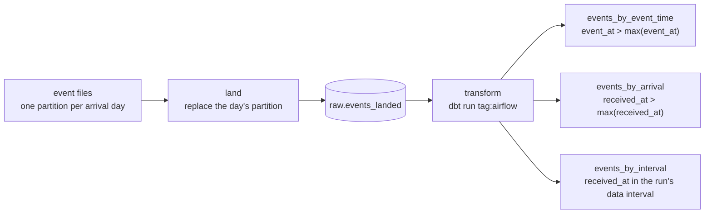

# Airflow: daily incremental loads, late files and backfills

The Airflow project of [data-stack-lab](..). A daily DAG lands one day of event files
into the warehouse and runs three dbt incremental models that differ in one line, how
each decides what is new. September 2026 is then backfilled four ways, and every
table is scored against every event that arrived. Method and figures:
[MEASUREMENTS](../MEASUREMENTS.md#airflow-incremental-loads-and-backfills).



## The DAGs

[`dags/saas_daily.py`](dags/saas_daily.py) builds two DAGs from one function; they
differ only in their schedule.

| DAG | Schedule | A run fired at midnight on 11 Sep covers |
|---|---|---|
| `saas_daily` | `CronDataIntervalTimetable("0 0 * * *")` | 10 Sep 00:00 to 11 Sep 00:00 |
| `saas_daily_default_cron` | `"@daily"`, which Airflow 3 turns into a `CronTriggerTimetable` | the instant 11 Sep 00:00, nothing before it |

Each has two tasks. `land` replaces the day's partition in `raw.events_landed`, so a
re-run of a day cannot double it, and fails without retrying when the day's file is
missing (retrying in five minutes will not make it appear). `transform` runs the three
models with the run's data interval passed in as dbt vars. `max_active_runs=1`,
`catchup=False`, two retries.

## Results

| Scenario | 30 runs | `events_by_event_time` | `events_by_arrival` | `events_by_interval` |
|---|---|---:|---:|---:|
| In order, 1 → 30 Sep | all green | lost 2,034 (2.27%) | 0 | 0 |
| The 10 Sep file lands after the 12th's run; the 10th is re-run | 10th failed, re-run green | lost 4,841 (5.41%) | lost 2,889 (3.23%) | 0 |
| Backwards, 30 → 1 Sep (`--run-backwards`) | all green | lost 86,432 (96.56%) | lost 86,432 (96.56%) | 0 |
| Airflow 3's default `"@daily"`, in order | all green | lost 4,919 (5.50%) | lost 2,996 (3.35%) | **lost all 89,508** |

Of 89,508 distinct events that arrived in September, 2,291 arrived over an hour late.

- **Event time** loses late events even when nothing goes wrong: 2,034 of the 2,291.
- **Arrival time** is complete only while runs happen in order. Re-running the 10th
  after the 12th loaded nothing, because its high-water mark had already passed the
  10th; backwards, it kept only the first day it processed.
- **The data interval** is complete in every order, because each run asks for its own
  window and nothing else. It is also the only strategy the default schedule breaks: a
  window that starts and ends at the same instant contains nothing, and all 30 runs
  still succeeded. The `land` task on that schedule read the day that had just begun,
  not the one that had just ended, which is why the other two lost 1 September.

**On a real scheduler too.** [`scheduler_run.py`](scheduler_run.py) runs the in-order
scenario on `airflow standalone` with `airflow backfill create --dag-id saas_daily
--from-date 2026-09-01 --to-date 2026-09-30 --max-active-runs 1`: 30 of 30 runs succeeded
and all three tables were identical to the harness's
([`results/airflow-scheduler-run.json`](../results/airflow-scheduler-run.json)). It queues
the backfill before starting the scheduler, because SQLite takes one writer at a time.

## Running it

From the repository root, after `make data`:

```bash
make airflow                                   # uv sync --group airflow, then the backfill
uv run python airflow/backfill.py --check      # what CI runs: the published figures, exactly
uv run --group airflow pytest -q tests/test_dags.py
make airflow-scheduler                         # the in-order backfill on airflow standalone
```

[`backfill.py`](backfill.py) gives each scenario its own DuckDB file under
`data/airflow/` and its own `AIRFLOW_HOME`, and runs each day through `dag.test()`,
which executes the real tasks in-process. A day's run is fired the way the scheduler
fires it, at the midnight after the day.
