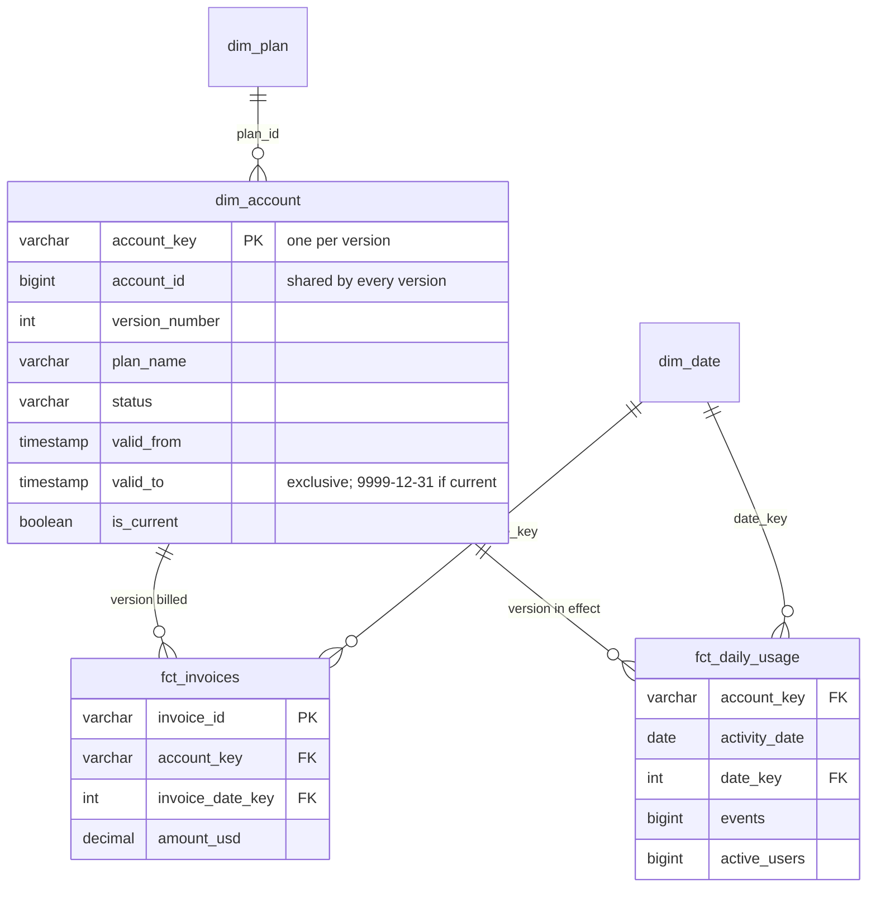

# dbt: a star schema with a Type 2 account dimension

The dbt project for [data-stack-lab](..). It turns the raw sources into a Kimball star
schema whose account dimension keeps history, built only from what monthly extracts of
the application database showed. Results and method: [README](../README.md#results-dimensional-modelling-in-dbt),
[MEASUREMENTS](../MEASUREMENTS.md).



## Layers

| Layer | Schema | What it does |
|---|---|---|
| sources | `raw` | as loaded: the current accounts extract, users, plans, invoices, events |
| snapshot | `snapshots` | `snap_accounts`: every version an extract showed, timestamp strategy on `updated_at` |
| staging | `staging` | views: types, e-mail normalised, redelivered events dropped |
| marts | `marts` | tables: `dim_account` (Type 2), `dim_plan`, `dim_date`, `dim_user` (Type 1), `fct_invoices`, `fct_daily_usage`, `revenue_by_plan` |

## Bus matrix

| Fact (grain) | dim_account | dim_date | dim_plan (through the account version) |
|---|:-:|:-:|:-:|
| `fct_invoices` (one invoice) | ✓ | ✓ | ✓ |
| `fct_daily_usage` (account version × day) | ✓ | ✓ | ✓ |

## Tests

- **Contracts** enforced on `dim_account`, `fct_invoices` and `fct_daily_usage`: column
  names and types are checked before the table is built.
- **Data tests** (46): keys unique and not null, relationships from facts to
  dimensions, accepted values, one current version per account, validity windows
  that neither overlap nor leave gaps ([`tests/generic/valid_windows.sql`](tests/generic/valid_windows.sql)),
  the usage grain, and two reconciliations: the invoice fact holds exactly the
  billing export's invoices and money, and daily usage counts every event once.
- **Unit tests** (3): a redelivered event counts once; the first version reaches back
  to signup and the open one ends at 9999-12-31; an invoice takes the version in
  effect when it was billed.

## Running it alone

From the repository root, after `make data`:

```bash
uv run python scripts/warehouse.py   # 13 snapshot loads, then dbt build
cd dbt && DUCKDB_PATH=../data/warehouse.duckdb uv run dbt docs generate --profiles-dir .
```

`profiles.yml` has one target, `duckdb`. The Snowflake, Databricks and BigQuery
modules add theirs and run this same project.
